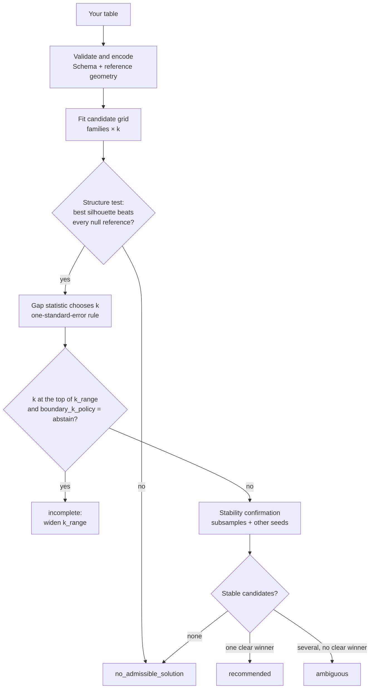

<div align="center">

# Clustelia

<p align="center">
  
</p>

### Clustering with evidence, not guesswork.

Clustelia tries many clustering models on your data, checks whether the result is real
and stable, and **tells you when there is no clustering worth trusting**.

[](https://www.python.org/)
[](https://github.com/jaimevera1107/clustelia/blob/main/LICENSE)
[](https://pypi.org/project/clustelia/)

[](https://github.com/jaimevera1107/clustelia/actions/workflows/tests.yml)

[What it is](#what-is-clustelia) · [Install](#installation) · [Quick start](#quick-start) · [Usage guide](#usage-guide) · [How it decides](#how-clustelia-decides) · [Scope and limits](#scope-and-limitations) · [Docs](#documentation)

</div>

---

## What is Clustelia?

Any clustering algorithm will split your data into groups, **even when the data has no
groups at all**. Run k-means with `k=4` on random noise and you get four clusters, nicely
coloured, completely meaningless. Choosing the algorithm and the number of clusters, and
checking that the answer is not an artefact, is usually left to the analyst.

Clustelia automates that workflow and makes every decision auditable:

1. **Searches** a grid of algorithms (k-means, medoids, Ward, spectral, BIRCH, Gaussian
   mixtures, DBSCAN/HDBSCAN, fuzzy c-means…) and numbers of clusters.
2. **Compares them fairly**, scoring every candidate in the same reference geometry.
3. **Tests for structure**: the best partition must beat what the same search finds on
   structureless "null" versions of your data.
4. **Checks stability**: the winner is refitted on subsamples and with other random seeds
   and must reproduce itself.
5. **Recommends one solution, or abstains.** "No reliable clustering" is a valid,
   explicit answer, never a silent failure.

The result is an object you can interrogate: why each candidate was rejected, how stable
the winner is, what characterises each cluster, and a report you can export.

```text
your table ──► search many models ──► structure test ──► stability check ──► recommended
                                            │                    │             or abstains
                                            └─ fails ────────────┴───────────► (with reasons)
```

### Is it for you?

| Good fit | Not a good fit (today) |
|:--|:--|
| Segmenting customers, firms, regions, survey respondents | Time series, panels or grouped data (rows must be resampleable independently) |
| Numeric, categorical, ordinal, binary or **mixed** tables | Large tables with pairwise methods (a few thousand rows hit the memory guard) |
| You need to justify *why* a segmentation is credible | Streaming or out-of-core clustering |
| You would rather get "no answer" than a misleading one | Images, text or graphs without a prior tabular representation |
| Reproducible analyses (fixed seeds, logged decisions) | Production-critical systems (the library is an alpha) |

## Installation

Requires **Python 3.11+**.

```bash
pip install clustelia            # core library
pip install "clustelia[all]"     # with every optional feature
```

The development version installs straight from GitHub:
`pip install "clustelia @ git+https://github.com/jaimevera1107/clustelia.git"`.

| Extra | Adds | Needed for |
|:--|:--|:--|
| `viz` | matplotlib | `plot_*` methods |
| `reports` | openpyxl | `export_report("file.xlsx")` |
| `density` | hdbscan | the DBCV score used by the density objective |
| `fuzzy` | scikit-fuzzy | fuzzy c-means |
| `all` | everything above | |

## Quick start

```python
from sklearn.datasets import load_iris
from clustelia import cluster

X = load_iris(as_frame=True).data          # 150 flowers, 4 measurements

result = cluster(X, random_state=42)

print(result.selection_status)             # 'recommended'
print(result.report(top=3))                # human-readable summary

solution = result.recommended_solution()   # None when Clustelia abstains
if solution is not None:
    print(solution.sizes_table())
    print(solution.profile_table())
```

Output of `report()` (abridged, scores rounded):

```text
# Clustelia experiment
- Selection: **recommended**
- Objective: compact
- Fit attempts: 246
- Candidates evaluated: 21
- Recommendation: kmeans (3 clusters)

| recommended | algorithm     | n_clusters | coverage | silhouette | confirmed |
|-------------|---------------|------------|----------|------------|-----------|
| True        | kmeans        | 3          | 1.0      | 0.460      | True      |
| False       | medoids       | 3          | 1.0      | 0.451      | True      |
| False       | agglomerative | 3          | 1.0      | 0.447      | True      |
```

21 candidates were evaluated, 246 fits were spent in total (including null references and
stability checks), and three clusters were recommended.

### Reading the result

Every run ends in one of four states. **Always check it before using labels.**

| `selection_status` | Meaning | What to do |
|:--|:--|:--|
| `recommended` | One candidate passed the structure test and the stability checks. | Use `result.recommended_solution()`. |
| `no_admissible_solution` | Nothing passed: no structure beyond the null reference, or nothing was stable. | Treat it as a finding. `ranking_table()` shows each rejection reason. |
| `ambiguous` | Several candidates passed but none is clearly better. | Inspect `metadata["admissible_candidates"]` and choose with domain knowledge via `result.select(id)`. |
| `incomplete` | The protocol could not finish (budget exhausted, backend missing, a fit failed). | Read `summary()["incomplete_reasons"]`, then raise the budget or install the extra. |

`result.summary()` returns the key facts as a dictionary: `status`, `algorithm`,
`n_clusters`, `selected_k`, `selected_k_at_boundary`, `null_family`, `fits_used`,
`selection_warnings`, `incomplete_reasons`, and more.

## Usage guide

Every snippet below is self-contained and was run against the current `main`.

### 1. When there are no clusters

This is the case Clustelia was built for. A single Gaussian cloud has no groups:

```python
import numpy as np
from clustelia import cluster

X = np.random.default_rng(0).normal(size=(300, 4))

result = cluster(X, random_state=0)
print(result.selection_status)                         # 'no_admissible_solution'
print(result.recommended_solution())                   # None
print(result.metadata["structure_test"]["passed"])     # False

# The fitted candidates stay available, but choosing one by hand does NOT validate it
best_id = result.ranking_table(top=1)["candidate_id"].iloc[0]
print(result.select(best_id).sizes_table())
```

The structure test failed, so no stability fits were spent and nothing was recommended.
A plain k-means would have returned four clusters here without complaint.

### 2. Mixed data (numeric + categorical + ordinal + binary)

Declare what each column means. Clustelia never guesses ordinal order or binary
semantics; with mixed types it uses [Gower distance](https://github.com/jaimevera1107/clustelia/blob/main/docs/METHODS.md).

```python
import numpy as np
import pandas as pd
from clustelia import AutoCluster, GeometrySpec, Schema

rng = np.random.default_rng(1)
n = 150
firms = pd.DataFrame({
    "firm_id": np.arange(2 * n),
    "revenue": np.r_[rng.normal(100, 15, n), rng.normal(300, 40, n)],
    "employees": np.r_[rng.integers(2, 20, n), rng.integers(40, 200, n)],
    "sector": np.r_[rng.choice(["retail", "services"], n, p=[0.6, 0.4]),
                    rng.choice(["retail", "manufacturing"], n, p=[0.2, 0.8])],
    "size": np.r_[rng.choice(["small", "medium"], n, p=[0.8, 0.2]),
                  rng.choice(["medium", "large"], n, p=[0.3, 0.7])],
    "exports": np.r_[rng.binomial(1, 0.1, n), rng.binomial(1, 0.6, n)],
})

model = AutoCluster(
    schema=Schema(
        numeric=["revenue", "employees"],
        categorical=["sector"],                          # unordered labels
        ordinal={"size": ("small", "medium", "large")},  # order matters
        binary=["exports"],                              # 1 = presence; joint zeros ignored
        identifiers=["firm_id"],                         # kept out of the distance
    ),
    geometry=GeometrySpec(kind="gower", scaling="none"),
    k_range=(2, 3, 4, 5),
    random_state=42,
).fit(firms)

result = model.result_
summary = result.summary()
print(summary["status"], summary["algorithm"], summary["n_clusters"])
print(summary["selected_k_at_boundary"])                 # True means: widen k_range

solution = result.recommended_solution()
if solution is not None:
    print(solution.feature_importance_table())           # which variables separate clusters
    print(solution.profile_table())                      # per-cluster medians, top categories
```

With an explicit `Schema` every column must be declared exactly once. Without one,
numeric dtypes are treated as numeric, everything else as nominal, and columns clearly
named as IDs (`id`, `firm_id`, `uuid`…) with unique values are excluded automatically.

In this example the selected `k` sits at the top of `k_range`: nominal categories that
are only partly aligned with the two groups split them further. That is exactly what
`selected_k_at_boundary` is there to surface; `SelectionPolicy(boundary_k_policy=
"abstain")` turns it into an abstention (see §7).

Missing values are rejected by default. Gower can compare each pair on its observed
features with explicit safeguards: `GeometrySpec(kind="gower", scaling="none",
missing="pairwise", min_comparable_share=0.25)`.

### 3. Choosing algorithms and the range of k

```python
from sklearn.datasets import make_blobs
from clustelia import AutoCluster, CandidateSpec, GeometrySpec, SearchBudget

X, _ = make_blobs(n_samples=400, centers=4, cluster_std=0.8, random_state=7)

# a) Automatic grid: these families × these k values
model = AutoCluster(
    families=("kmeans", "agglomerative", "medoids"),
    k_range=range(2, 9),
    geometry=GeometrySpec(kind="euclidean", scaling="robust"),
    random_state=0,
)
plan = model.plan(X)                     # validates and lists candidates, fits nothing
print(len(plan["candidates"]), "candidates planned")
model.fit(X)

# b) Explicit candidates (mutually exclusive with `families`)
model = AutoCluster(
    candidates=(
        CandidateSpec("kmeans", k=4),
        CandidateSpec("kmeans", k=4, pca_variance=0.95),  # fitted on PCA, scored in the reference geometry
        CandidateSpec("agglomerative", k=4),
    ),
    budget=SearchBudget(max_fits=200, timeout_s=300),
    random_state=0,
).fit(X)
print(model.result_.selection_status)
```

`adapter_capabilities()` lists every algorithm, its objective, its backend and whether it
can assign new rows. Ward, spectral, DBSCAN, OPTICS and HDBSCAN are transductive
(no `predict`).

### 4. scikit-learn style: fit, labels, predict new rows

`AutoCluster` is a scikit-learn estimator. Instead of returning labels nobody validated,
`labels_` and `predict` raise `NoRecommendationError` when the search abstained.

```python
from sklearn.datasets import load_iris
from sklearn.model_selection import train_test_split
from clustelia import AutoCluster, NoRecommendationError

X = load_iris(as_frame=True).data
X_train, X_new = train_test_split(X, random_state=0)

model = AutoCluster(families=("kmeans", "medoids"), k_range=range(2, 7), random_state=0)
model.fit(X_train)

try:
    print(model.labels_[:10])
    print(model.predict(X_new)[:10])     # assigns new rows to the recommended clusters
except NoRecommendationError:
    print("No validated clustering: nothing to predict with.")
```

### 5. Checking against known labels

When ground truth exists (benchmarks, sanity checks), compare every candidate with it.
The labels are only used for this table, never for selection.

```python
from sklearn.datasets import load_iris
from clustelia import cluster

data = load_iris(as_frame=True)
result = cluster(data.data, random_state=0)
print(result.external_evaluate(data.target).head())   # ARI and NMI per candidate
```

### 6. Other objectives: probabilistic, density, fuzzy

Each objective has its own scoring rule, and scores are never compared across objectives.
**The structure test only exists for the compact objective**: these searches cannot
abstain for lack of structure and deserve more scrutiny.

```python
from sklearn.datasets import make_blobs, make_moons
from clustelia import AutoCluster

# Gaussian mixtures selected by BIC; the solution carries soft memberships
X, _ = make_blobs(n_samples=400, centers=4, cluster_std=0.8, random_state=7)
gmm = AutoCluster(objective="probabilistic", families=("gmm",),
                  k_range=range(2, 7), random_state=0).fit(X)
print(gmm.result_.selection_status, gmm.result_.summary()["n_clusters"])
print(gmm.result_.recommended_solution().membership_)

# Density-based clustering (DBSCAN / OPTICS / HDBSCAN) scored with DBCV
X_moons, _ = make_moons(n_samples=400, noise=0.06, random_state=0)
result = AutoCluster(objective="density", random_state=0).fit(X_moons).result_
print(result.selection_status)                         # often 'ambiguous'
for candidate_id in result.metadata["admissible_candidates"]:
    print(candidate_id, result.select(candidate_id).sizes_table()["size"].tolist())
```

`ambiguous` is common for density and fuzzy searches: several admissible partitions can
be practically identical (on the two moons above both admissible candidates recover the
moons; one of them also flags a single point as noise) and no tie tolerance is calibrated for these scores, so the final
choice is left to you, explicitly. Fuzzy c-means works the same way with
`objective="fuzzy"` and the `fuzzy` extra.

### 7. How much evidence: effort presets and selection policy

`cluster()` offers three presets. They trade runtime for evidence; they are **not**
confidence levels.

| `effort` | Null replicates | Subsamples | Max fits | Use it for |
|:--|--:|--:|--:|:--|
| `quick` | 2 | 3 | 100 | A first look; weak evidence |
| `balanced` (default) | 9 | 10 | 320 | Normal analysis |
| `thorough` | 19 | 15 | 800 | Results you will report or publish |

For finer control pass a `SelectionPolicy`:

```python
from sklearn.datasets import make_blobs
from clustelia import SelectionPolicy, cluster

X, _ = make_blobs(n_samples=400, centers=4, cluster_std=0.8, random_state=7)

policy = SelectionPolicy(
    null_replicates=19,               # Monte Carlo resolution 1/(19+1) = 5%
    null_family="gaussian_copula",    # experimental null reference, see below
    boundary_k_policy="abstain",      # never recommend a k stuck at the top of k_range
)
result = cluster(X, effort="thorough", selection=policy, random_state=0)
print(result.summary()["status"], result.summary()["selected_k"])   # recommended 4
```

> [!IMPORTANT]
> More null replicates need more fits. The same policy with the default `balanced`
> budget (320 fits) ends as `incomplete`, reason *"search grid or confirmation truncated
> by candidate/fit/time budget"*. Use `effort="thorough"` or
> `budget=SearchBudget(max_fits=...)`.

| Option | Values | Effect |
|:--|:--|:--|
| `null_replicates` | int, default 9 | Depth of the structure test. `0` disables it: no structural validation at all. |
| `null_family` | `"auto"`, `"pca_uniform"`, `"gaussian_copula"`, `"permutation"` | What "no structure" looks like. `auto` uses a uniform box on the principal axes (numeric) or column permutations (Gower). `gaussian_copula` keeps every marginal distribution and the rank correlation, so one *skewed* cloud is not mistaken for clusters. Experimental, numeric only. |
| `boundary_k_policy` | `"warn"` (default), `"abstain"` | What happens when the gap statistic picks the largest `k` you allowed. |
| `k_selection` | `"auto"`, `"gap"`, `"silhouette"` | Rule for the number of clusters. |
| `SelectionPolicy.p0()` | | Legacy policy without structure test. Different evidence, not an equivalent default. |

Why the copula option exists: in a 30-seed development study the default reference
recommended clusters for 17–20 of 30 single skewed (lognormal) clouds, the copula for
0–1 of 30, while both detected 29–30 of 30 real three-group mixtures. Full table and
caveats in [VALIDATION.md](https://github.com/jaimevera1107/clustelia/blob/main/docs/VALIDATION.md).

### 8. Reports, plots and saving

```python
from sklearn.datasets import load_iris
from clustelia import cluster, load, save

result = cluster(load_iris(as_frame=True).data, random_state=0)

result.export_report("clusters.html")   # also .md, .json, .csv, .xlsx (needs `reports`)

solution = result.recommended_solution()
# Plots need the `viz` extra and return matplotlib Axes, e.g.:
#   solution.plot_sizes()
#   solution.plot_profile("petal length (cm)")
#   solution.plot_importance()
#   solution.plot_projection()
#   result.plot_candidates()

save(result, "result.pkl")
restored = load("result.pkl", trusted=True)
```

> [!CAUTION]
> Saved files are Python pickles: they can contain your training data, identifiers
> included, and loading one can execute code. Only load files you created yourself.

## How Clustelia decides

For the default **compact** objective, selection makes three separate decisions:



1. **Is there structure?** The best silhouette of the grid is compared with the best
   silhouette the *same search* obtains on structureless datasets built from your data.
   It must beat all of them.
2. **How many clusters?** The gap statistic (Tibshirani, Walther and Hastie, 2001) reuses
   those reference fits and picks the smallest `k` within one standard error of the best.
   A `k` at the edge of `k_range` is flagged.
3. **Which candidate?** Candidates are refitted on 80% subsamples and with other seeds.
   They must keep coverage ≥ 0.8 and a median adjusted Rand index ≥ 0.7. Near-ties in
   silhouette (within 0.02) are broken by stability, coverage and cost.

Every fit, including failures and null references, counts against `SearchBudget`; when
the budget runs out the result is `incomplete`, never a quietly weaker recommendation.

The structure test is a screening rule, **not a proof** that natural clusters do or do
not exist. With 9 replicates its nominal resolution is 10%, and because the references
are built from your data that rate is not an exact guarantee. Definitions, formulas and
references are in [METHODS.md](https://github.com/jaimevera1107/clustelia/blob/main/docs/METHODS.md).

## Algorithms

| Objective | Families | Selected by |
|:--|:--|:--|
| `compact` (default) | k-means, MiniBatch k-means, bisecting k-means, BIRCH, spectral, Ward, medoids, CLARA, Gower k-prototypes | Structure test, gap statistic and stability, with silhouette in the reference geometry |
| `probabilistic` | Gaussian mixture, Bayesian Gaussian mixture | BIC or held-out log-likelihood, then stability |
| `density` | DBSCAN, OPTICS, HDBSCAN | DBCV, then stability |
| `fuzzy` | Fuzzy c-means | Generalised Xie–Beni index, then stability |

## Scope and limitations

What Clustelia **does** guarantee: every decision is logged, results are reproducible
from `random_state`, inputs are never modified or silently imputed, and an unfinished or
unsupported analysis is reported as such.

What it **does not** guarantee:

- **That clusters matter for your problem.** Statistical structure is not practical
  relevance; profiles still need interpretation.
- **Calibrated error rates.** The structure test has a nominal resolution, not a
  certified false-positive rate.
- **Independent rows.** Subsampling assumes rows can be resampled independently; time
  series, panels and grouped designs violate this.
- **Scale.** Ward and dense medoids build pairwise matrices; at a few thousand rows they
  hit the default 256 MiB guard (`SearchBudget(max_pairwise_mb=...)`). CLARA is an
  opt-in approximation for medoids, not an out-of-core workflow.
- **Wide nominal data.** On several categorical OpenML datasets (dermatology, mushroom,
  lymph, credit-approval) the default policy abstains where a silhouette-based policy
  finds weak partitions. Review the evidence before switching policies.
- **Non-compact objectives** have no structure test (§6).
- **Maturity.** `0.1.0` is the first public release of an alpha-stage library;
  the API may still change before 1.0.

The validation, failures and abstentions included, covers synthetic benchmarks and 18
public OpenML datasets with development and reserved splits: [VALIDATION.md](https://github.com/jaimevera1107/clustelia/blob/main/docs/VALIDATION.md).

## Documentation

| Guide | Contents |
|:--|:--|
| [Convenience API](https://github.com/jaimevera1107/clustelia/blob/main/docs/CONVENIENCE_API.md) | `cluster()`, presets, identifier detection, reports |
| [Methods](https://github.com/jaimevera1107/clustelia/blob/main/docs/METHODS.md) | Geometry, algorithms, structure test, gap statistic, stability, formulas |
| [Validation](https://github.com/jaimevera1107/clustelia/blob/main/docs/VALIDATION.md) | Benchmarks, results, limitations, reproducibility |
| [Development changes](https://github.com/jaimevera1107/clustelia/blob/main/docs/DEV2_CHANGES.md) | Gower comparability, CLARA, large tables |
| [Roadmap](https://github.com/jaimevera1107/clustelia/blob/main/docs/ROADMAP.md) | Planned work |
| [`examples/`](https://github.com/jaimevera1107/clustelia/tree/main/examples) | Runnable scripts: numeric, mixed, ordinal/binary, probabilistic, density, fuzzy |

## Development

```bash
git clone https://github.com/jaimevera1107/clustelia.git
cd clustelia
pip install -e ".[dev,all]"

python -m pytest            # test suite
ruff check src tests tools  # lint
mypy                        # type checks
python tools/verify_all.py  # every CI step, with a report
```

Contribution guidelines: [CONTRIBUTING.md](https://github.com/jaimevera1107/clustelia/blob/main/CONTRIBUTING.md). History:
[CHANGELOG.md](https://github.com/jaimevera1107/clustelia/blob/main/CHANGELOG.md). Bugs and proposals:
[GitHub Issues](https://github.com/jaimevera1107/clustelia/issues).

## License

[MIT](https://github.com/jaimevera1107/clustelia/blob/main/LICENSE).

<sub>Logo created with ChatGPT (OpenAI).</sub>
